# Lua & Linha 🌙🎣

**Descubra se hoje é um bom dia para pescar e o que levar na caixa de pesca.**


[](https://sonarcloud.io/summary/new_code?id=MuriloDalMolim_Lua-e-Linha)

## 1. Sobre o projeto

Projeto acadêmico desenvolvido para a disciplina de **Integração Contínua** da UTFPR-DV, curso de Engenharia de Software.

O **Lua & Linha** é uma Single Page Application (SPA) de apoio à pesca amadora. A aplicação reúne, em um só lugar, informações que o pescador costuma buscar antes de sair: as condições do dia e o equipamento adequado para o peixe que pretende pescar.

**Aplicação publicada:** https://murilodalmolim.github.io/Lua-e-Linha/

## 2. Serviço proposto

### Problema que o serviço pretende resolver

Antes de uma pescaria, o pescador amador costuma consultar várias fontes diferentes: calendários lunares, previsões do tempo, vídeos e fóruns sobre iscas e equipamentos. Essas informações ficam espalhadas e nem sempre são fáceis de interpretar.

O Lua & Linha centraliza essas informações e as traduz em respostas diretas para duas perguntas:

- **Quando ir?** Uma previsão que indica se a data escolhida é favorável para a pesca.
- **O que levar?** Uma recomendação de equipamento de acordo com a espécie e o ambiente.

### Público-alvo

- Pescadores amadores e iniciantes que querem planejar melhor suas pescarias.
- Praticantes de pesca esportiva em rios, represas e pesque-pagues.
- Pessoas que pescam como lazer em família e não conhecem equipamentos e técnicas.

### Possibilidades de monetização

A interface já prevê os espaços destinados à monetização, identificados pelo componente `AdSlot`:

- **Banners publicitários**: espaço no topo de todas as páginas, no formato padrão _leaderboard_ (728×90), destinado a lojas de pesca e pesqueiros da região.
- **Conteúdo patrocinado**: cards em destaque nas páginas para pesqueiros e marcas parceiras.
- **Links de afiliado**: os equipamentos recomendados pelo guia poderão direcionar para lojas parceiras, com comissão sobre as vendas.
- **Destaque pago**: pesqueiros e lojas poderão pagar para aparecer com prioridade nas recomendações da sua cidade.

A monetização não está implementada; os espaços são marcados na interface para demonstrar o modelo de negócio.

## 3. Funcionalidades

### Disponíveis

- **Previsão pela fase da lua**: o usuário escolhe uma data e a aplicação mostra a fase da lua, o percentual de iluminação, uma avaliação para a pesca (boa, regular ou fraca) e uma dica.
- **Guia de equipamentos**: o usuário escolhe o ambiente (rio, represa ou mar) e a espécie, e a aplicação recomenda vara, linha, anzol, iscas e técnica, com uma dica para aquele ambiente.
- **Espaços de anúncio e conteúdo patrocinado** em todas as páginas.
- **Página de erro** para endereços inexistentes.

### Planejadas

- **Índice de pesca do dia**: nota de 0 a 10 combinando a fase da lua com dados de clima (pressão atmosférica, vento e temperatura) obtidos da API pública [Open-Meteo](https://open-meteo.com).

## 4. Tecnologias utilizadas

**Frontend**

- React + Vite
- React Router (`HashRouter`)
- CSS puro

**Qualidade**

- ESLint
- [SonarQube Cloud](https://sonarcloud.io) — análise estática e Quality Gate

**Versionamento**

- Git
- [GitHub](https://github.com) — repositório, branches e Pull Requests

**Testes**

- Vitest
- @vitest/coverage-v8 — cobertura de testes

**Segurança**

- Dependabot — atualização e alertas de dependências
- npm audit — vulnerabilidades em dependências
- CodeQL — análise estática de segurança (SAST)
- Gitleaks e GitHub Secret Protection — detecção de segredos

**CI/CD e hospedagem**

- [GitHub Actions](https://github.com/features/actions) — pipeline de CI/CD e monitoramento
- [GitHub Pages](https://pages.github.com) — hospedagem da aplicação

## 5. Arquitetura da aplicação

A aplicação é uma SPA sem backend: todo o código roda no navegador, e os dados são calculados localmente ou obtidos de arquivos e APIs públicas.

### Separação entre interface e lógica

Os componentes em `pages/` e `components/` cuidam apenas da exibição. As regras do serviço, como o cálculo da fase da lua, ficam em `lib/`, em funções puras que recebem uma entrada e devolvem um resultado. Essa separação permite testar a lógica de forma automatizada, sem depender da interface.

### Roteamento

A navegação utiliza o `HashRouter` do React Router, com endereços no formato `/#/previsao`. Essa escolha considera a hospedagem em serviços de arquivos estáticos, como o GitHub Pages: a parte do endereço após o `#` não é enviada ao servidor, que sempre entrega o `index.html`. Com isso, atualizar a página ou acessar um endereço diretamente funciona sem configuração adicional no servidor.

## 6. Estratégia de branches e versionamento

### GitHub Flow

O projeto segue o **GitHub Flow**, escolhido por ser simples e adequado a um fluxo de entrega contínua:

- A branch `main` contém sempre uma versão estável, pronta para ser publicada.
- Cada mudança é desenvolvida em uma branch própria, criada a partir da `main`.
- A mudança entra na `main` por meio de um **Pull Request**, que registra o que foi alterado e como testar.
- O merge é feito com **merge commit**, preservando os commits individuais e marcando no histórico a entrada de cada Pull Request.
- Após o merge, a branch é removida.

```
main ──●──────────────────●──────────────●──
        \                / (merge do PR)
         feature/...   ●──●──●
```

### Proteção da branch principal

A branch `main` é protegida por uma regra (_ruleset_) no GitHub, que:

- exige Pull Request para qualquer alteração;
- exige que o pipeline (`Lint, test and build`) seja concluído com sucesso antes do merge;
- exige que a análise do CodeQL não aponte alertas de segurança de severidade alta ou crítica;
- bloqueia _force push_, impedindo a reescrita do histórico;
- impede a exclusão da branch.

### Padrão de commits

As mensagens de commit seguem o padrão [Conventional Commits](https://www.conventionalcommits.org), em inglês. O tipo no início da mensagem indica a natureza da mudança.

### Versionamento

O projeto segue o [Versionamento Semântico](https://semver.org/lang/pt-BR/) (SemVer), no formato `MAJOR.MINOR.PATCH`:

| Parte | Quando muda                                        |
| ----- | -------------------------------------------------- |
| MAJOR | Mudanças incompatíveis com a versão anterior       |
| MINOR | Novas funcionalidades compatíveis (commits `feat`) |
| PATCH | Correções compatíveis (commits `fix`)              |

A versão fica registrada no `package.json`. Cada versão entregue é preparada em uma branch `release/X.Y.Z`, incorporada à `main` por Pull Request, marcada com uma tag `vX.Y.Z` e publicada como _Release_ no GitHub, com as notas geradas a partir dos Pull Requests incluídos.

**Versão atual: 1.0.0**, a primeira versão completa, com a previsão pela fase da lua, o guia de equipamentos e o processo de CI/CD com testes, qualidade, segurança, deploy e monitoramento.

## 7. Pipeline CI/CD

### Ferramenta utilizada

O pipeline utiliza o **GitHub Actions**, com o workflow definido em `.github/workflows/ci.yml`. A execução ocorre em uma máquina virtual Ubuntu criada pelo GitHub a cada execução, sem dependência do ambiente local do desenvolvedor.

### Quando o pipeline é executado

- **Pull Request para a `main`**: valida a mudança antes do merge. O resultado aparece no próprio Pull Request.
- **Push na `main`**: executado após cada merge. Além das validações, gera o artefato e publica a aplicação no GitHub Pages.

O merge na `main` só é permitido quando o pipeline é concluído com sucesso.

### Etapas do pipeline

Checkout → Secret scan → Setup Node.js → Install dependencies → Dependency audit → Lint → Tests and coverage → SonarQube Scan → Build → Upload Pages artifact → Deploy → Post-deploy check

| Etapa                 | O que faz                                                                                                                    |
| --------------------- | ---------------------------------------------------------------------------------------------------------------------------- |
| Checkout              | Baixa o código do repositório com o histórico completo, usado pelo SonarQube para identificar o código novo                  |
| Secret scan           | Procura segredos (tokens, chaves e senhas) nos commits com o Gitleaks                                                        |
| Setup Node.js         | Instala o Node.js 22 e restaura o cache de dependências                                                                      |
| Install dependencies  | Instala as dependências com `npm ci`, usando exatamente as versões do `package-lock.json`                                    |
| Dependency audit      | Verifica vulnerabilidades conhecidas nas dependências com `npm audit` e falha se houver alguma de severidade alta ou crítica |
| Lint                  | Analisa o código com o ESLint                                                                                                |
| Tests and coverage    | Executa os testes automatizados com o Vitest e gera o relatório de cobertura                                                 |
| SonarQube Scan        | Envia o código e a cobertura ao SonarQube Cloud e aguarda o resultado do Quality Gate                                        |
| Build                 | Gera a versão de produção da aplicação na pasta `dist/`                                                                      |
| Upload Pages artifact | Empacota a pasta `dist/` como artefato da execução (somente em push na `main`)                                               |
| Deploy                | Job separado que publica o artefato no GitHub Pages (somente em push na `main` e após o sucesso do build)                    |
| Post-deploy check     | Job que executa o health check na aplicação recém-publicada (somente em push na `main` e após o sucesso do deploy)           |

As etapas são executadas em sequência. Se qualquer uma falhar, as seguintes não são executadas e o pipeline é marcado como falho.

### Como verificar uma execução

1. Acesse a aba **Actions** do repositório e selecione uma execução do workflow **CI**.
2. Abra o job **Lint, test and build** para ver o resultado e os logs de cada etapa.
3. Em um Pull Request, o resultado também aparece na seção de verificações, ao final da página.

### Outras automações

- **CodeQL** (`.github/workflows/codeql.yml`): análise de segurança do código, executada em Pull Requests, em pushes na `main` e semanalmente.
- **Dependabot** (`.github/dependabot.yml`): verificação semanal de atualizações das dependências npm e das actions dos workflows.
- **Monitoramento** (`.github/workflows/monitor.yml`): verificação agendada da aplicação publicada (ver [Monitoramento e observabilidade](#13-monitoramento-e-observabilidade)).

## 8. Testes automatizados

Os testes utilizam o **Vitest** e ficam ao lado do código que testam, com a extensão `.test.js`.

A lógica do serviço fica isolada em funções puras na pasta `src/lib/`, separada dos componentes de interface. Isso permite testar as regras do serviço de forma automatizada, sem depender da tela.

### Cálculo da fase da lua

O arquivo `src/lib/moonPhase.test.js` verifica a função de cálculo com datas reais de fases da lua, obtidas de tabelas astronômicas:

- lua nova, quarto crescente, lua cheia e quarto minguante de janeiro de 2000;
- uma data anterior à data de referência do cálculo;
- a volta ao início após um ciclo lunar completo;
- a idade da lua sempre dentro do intervalo do ciclo, para datas entre 1990 e 2030;
- o uso da data atual quando nenhuma data é informada.

As datas dos testes são definidas em UTC, para que o resultado seja o mesmo no computador do desenvolvedor e no pipeline.

### Recomendação de equipamentos

O arquivo `src/lib/recommendation.test.js` verifica:

- a lista de espécies de cada ambiente, que deve conter apenas espécies que vivem nele;
- a recomendação completa para uma espécie em um ambiente;
- o retorno vazio quando a espécie não vive no ambiente, quando a espécie ou o ambiente não existem e quando nada foi selecionado.

Também há testes de integridade dos dados do `guide.json`: cada espécie deve ter todas as informações de equipamento, usar apenas ambientes cadastrados e ter uma dica para cada ambiente. Assim, um erro ao editar o arquivo de dados é detectado pelo pipeline antes de chegar à aplicação.

### Cobertura

A cobertura é medida com o `@vitest/coverage-v8` e considera todos os arquivos de `src/`, inclusive os que não possuem testes. O relatório é exibido no log do pipeline e gerado no formato LCOV (`coverage/lcov.info`), utilizado pela análise de qualidade.
Os testes automatizados se concentram nas regras do serviço, em `src/lib/`. Os componentes de interface não possuem testes automatizados nesta versão e, por isso, são desconsiderados no cálculo de cobertura do SonarQube (ver [Qualidade de código](#9-qualidade-de-código)).

### Executando os testes

```bash
npm test               # executa os testes uma vez
npm run test:watch     # executa os testes a cada alteração
npm run coverage       # executa os testes e gera o relatório de cobertura
```

## 9. Qualidade de código

A qualidade do código é verificada em duas etapas do pipeline: lint e análise estática.

### Lint

O **ESLint** verifica erros comuns e padrões de código, com as regras definidas em `eslint.config.js`. Entre elas, variáveis declaradas e não utilizadas são tratadas como erro. Uma falha no lint interrompe o pipeline antes dos testes e do build.

### Análise estática

O **SonarQube Cloud** analisa o código em busca de bugs, vulnerabilidades, _code smells_ e duplicações, e utiliza o relatório de cobertura gerado pelo Vitest. A configuração fica no arquivo `sonar-project.properties`:

| Propriedade                               | Função                                                           |
| ----------------------------------------- | ---------------------------------------------------------------- |
| `sonar.organization` e `sonar.projectKey` | Identificam o projeto no SonarQube Cloud                         |
| `sonar.sources` e `sonar.tests`           | Separam o código da aplicação dos arquivos de teste              |
| `sonar.javascript.lcov.reportPaths`       | Indica o relatório de cobertura (`coverage/lcov.info`)           |
| `sonar.coverage.exclusions`               | Desconsidera os componentes de interface no cálculo de cobertura |
| `sonar.qualitygate.wait`                  | Faz o pipeline aguardar e respeitar o resultado do Quality Gate  |

A análise automática do SonarQube Cloud está desativada. A análise é executada exclusivamente pelo pipeline, após os testes, para que o relatório de cobertura esteja disponível.

Em Pull Requests, o SonarQube analisa apenas o código alterado em relação à `main` e publica o resultado no próprio Pull Request.

### Quality Gate

O projeto utiliza o Quality Gate padrão **Sonar way**, que avalia o código novo quanto a cobertura, duplicações, confiabilidade, segurança e manutenibilidade.

### Cobertura considerada pelo Quality Gate

O Sonar way exige pelo menos 80% de cobertura no código novo. Como os testes se concentram nas regras do serviço, as páginas, os componentes e os arquivos de inicialização (`src/pages/`, `src/components/`, `App.jsx` e `main.jsx`) são desconsiderados no cálculo de cobertura. Dessa forma, a exigência de cobertura recai sobre a pasta `src/lib/`, onde estão as regras do serviço.

Esses arquivos continuam sendo analisados pelo SonarQube quanto a bugs, vulnerabilidades, _code smells_ e duplicações. A exclusão vale apenas para a métrica de cobertura.

Com `sonar.qualitygate.wait=true`, o resultado do Quality Gate passa a ser um critério do pipeline: se ele falhar, a etapa do SonarQube falha, o build não é executado e o merge do Pull Request é bloqueado.

### Autenticação

O token de acesso ao SonarQube Cloud é armazenado como GitHub Secret (`SONAR_TOKEN`) e lido pelo workflow apenas durante a execução. Nenhuma credencial é versionada no repositório.

## 10. Segurança

A segurança é verificada em diferentes pontos do processo. As ferramentas foram escolhidas por serem gratuitas para repositórios públicos, não exigirem infraestrutura própria e apresentarem os resultados no próprio GitHub, nos Pull Requests e na aba **Security**.

| Requisito                         | Ferramenta                          | Onde atua                                               |
| --------------------------------- | ----------------------------------- | ------------------------------------------------------- |
| Análise de dependências           | Dependabot                          | Configuração do repositório e Pull Requests automáticos |
| Identificação de vulnerabilidades | npm audit                           | Etapa do pipeline de CI                                 |
| SAST                              | CodeQL                              | Workflow próprio de análise                             |
| Secret scanning                   | Gitleaks e GitHub Secret Protection | Etapa do pipeline de CI e verificação no push           |
| Secrets e variáveis               | GitHub Secrets                      | Credenciais usadas pelos workflows                      |

### Análise de dependências

O **Dependabot** está configurado em `.github/dependabot.yml` e verifica semanalmente as dependências npm e as actions utilizadas nos workflows. As atualizações menores são agrupadas em um único Pull Request, com mensagens no padrão Conventional Commits.

Os alertas e as atualizações de segurança do Dependabot também estão habilitados: quando uma vulnerabilidade é publicada para uma dependência do projeto, é aberto um Pull Request com a versão corrigida. Assim como qualquer alteração, esses Pull Requests passam pelo pipeline antes do merge.

### Identificação de vulnerabilidades

A etapa **Dependency audit** executa `npm audit --audit-level=high`, que consulta o banco de vulnerabilidades do registro npm. Todas as vulnerabilidades encontradas são exibidas no log, e o pipeline falha quando há alguma de severidade alta ou crítica. As de severidade baixa ou moderada não interrompem o pipeline e são tratadas pelas atualizações do Dependabot.

### Análise estática de segurança (SAST)

O **CodeQL** analisa o código em busca de falhas de segurança, como injeção de código e uso inseguro de dados fornecidos pelo usuário. Ele é executado em um workflow próprio, em paralelo ao pipeline de CI, em Pull Requests, em pushes na `main` e semanalmente. A execução semanal permite identificar vulnerabilidades detectadas por novas regras mesmo sem alteração no código.

Os resultados ficam em **Security → Code scanning**, e a regra de proteção da `main` impede o merge de Pull Requests com alertas de severidade alta ou crítica.

### Secret scanning

A detecção de segredos ocorre em duas camadas:

- **Gitleaks**, na etapa **Secret scan** do pipeline, analisa os commits em busca de tokens, chaves e senhas. É a primeira validação após o checkout, e uma detecção interrompe o pipeline.
- **GitHub Secret Protection**, com _push protection_, verifica o repositório e bloqueia o push quando reconhece um segredo de um provedor conhecido, antes que ele chegue ao repositório remoto.

### Uso de secrets e permissões

- O token do SonarQube Cloud é armazenado como GitHub Secret (`SONAR_TOKEN`). Nenhuma credencial é versionada no repositório.
- O `GITHUB_TOKEN` usado pelos workflows é gerado pelo GitHub a cada execução e expira ao final do job.
- Os workflows declaram permissões mínimas (`permissions`). O pipeline de CI tem apenas permissão de leitura, e o CodeQL pode apenas publicar os resultados da análise de segurança. Isso limita o impacto caso uma action ou dependência seja comprometida.
- Os workflows disparados pelo Dependabot não têm acesso aos secrets do repositório, como proteção contra dependências maliciosas. Por isso, o `SONAR_TOKEN` também é cadastrado nos _Dependabot secrets_, permitindo que as atualizações automáticas passem pelo mesmo pipeline.

### Cadeia de suprimentos

- As dependências são instaladas com `npm ci`, que usa exatamente as versões registradas no `package-lock.json`.
- As actions utilizadas nos workflows também são monitoradas pelo Dependabot.
- O pipeline verifica dependências e segredos antes de qualquer etapa de build.

#### Riscos aceitos

| Pacote                                         | Severidade | Decisão                                                                                                                                                                                                                                                                                                                                                 |
| ---------------------------------------------- | ---------- | ------------------------------------------------------------------------------------------------------------------------------------------------------------------------------------------------------------------------------------------------------------------------------------------------------------------------------------------------------- |
| `minimatch` (dependência transitiva do ESLint) | Moderada   | Risco aceito. O pacote é usado apenas pelas ferramentas de desenvolvimento e não faz parte do build publicado. A única correção disponível exigiria retornar ao ESLint 9, uma versão major anterior. O alerta foi dispensado com justificativa no GitHub e será resolvido pela próxima atualização do ESLint, que o Dependabot proporá automaticamente. |

## 11. Build e artefatos

### Como o build é realizado

O build é feito pelo **Vite**, com o comando `npm run build`. Ele reúne o código da aplicação e das bibliotecas, remove o que não é utilizado, minifica os arquivos e gera a versão de produção na pasta `dist/`.

### Arquivos que constituem o artefato

| Arquivo                   | Conteúdo                                              |
| ------------------------- | ----------------------------------------------------- |
| `index.html`              | Página única da SPA                                   |
| `assets/index-[hash].js`  | Código da aplicação e das bibliotecas, minificado     |
| `assets/index-[hash].css` | Estilos da aplicação                                  |
| `vite.svg`                | Ícone da aba do navegador, copiado da pasta `public/` |

O `[hash]` no nome dos arquivos muda sempre que o conteúdo muda. Isso permite que o navegador mantenha os arquivos em cache e baixe uma nova versão apenas quando houver alteração.

A configuração `base: './'` no `vite.config.js` faz os caminhos dos arquivos serem relativos, permitindo que a aplicação funcione na subpasta do GitHub Pages.

### Em qual etapa o artefato é produzido

O build é executado em toda execução do pipeline, inclusive em Pull Requests, para garantir que a aplicação continua compilando. Em pushes na `main`, a etapa **Upload Pages artifact** empacota a pasta `dist/` e a armazena como artefato da execução, com o nome `github-pages`.

### Como o artefato é utilizado na publicação

O job de deploy não executa um novo build: ele publica exatamente o artefato gerado e validado pelo job de build. Dessa forma, a versão publicada é a mesma que passou por todas as verificações de qualidade e segurança.

## 12. Deploy

A aplicação é publicada no **GitHub Pages**, escolhido por ser gratuito, integrado ao GitHub Actions e adequado a uma SPA sem backend, que consiste apenas em arquivos estáticos.

**Endereço:** https://murilodalmolim.github.io/Lua-e-Linha/

### Fluxo

O deploy é um job separado do workflow de CI e é executado automaticamente após cada merge na `main`:

1. O job **Lint, test and build** executa todas as validações e gera o artefato.
2. O job **Deploy to GitHub Pages** só é iniciado se o build for concluído com sucesso (`needs: build`).
3. O artefato é publicado, e o endereço da aplicação é registrado no ambiente `github-pages`.
4. O job **Post-deploy check** verifica se a aplicação publicada responde corretamente, utilizando o mesmo health check do monitoramento.

Em Pull Requests, o job de deploy não é executado. Assim, apenas alterações revisadas e incorporadas à `main` chegam à aplicação publicada.

### Segurança do deploy

- Apenas o job de deploy possui permissão para publicar no GitHub Pages. O job de build tem somente permissão de leitura.
- A autenticação no GitHub Pages usa um token temporário (OIDC), gerado durante a execução. Não há credenciais armazenadas para o deploy.
- O ambiente `github-pages` aceita deploys apenas a partir da branch `main`.
- Deploys simultâneos são evitados (`concurrency`), garantindo que uma publicação termine antes da seguinte.

### Roteamento no GitHub Pages

O GitHub Pages serve apenas arquivos estáticos e não permite configurar o servidor para redirecionar todos os endereços ao `index.html`. Por isso, a aplicação utiliza o `HashRouter` (ver [Arquitetura da aplicação](#5-arquitetura-da-aplicação)): a rota fica após o `#` e não é enviada ao servidor, que sempre entrega o `index.html`.

## 13. Monitoramento e observabilidade

Após o deploy, a disponibilidade da aplicação publicada é verificada por um workflow próprio (`.github/workflows/monitor.yml`), separado do pipeline de CI/CD:

- **CI/CD**: verifica se uma nova versão pode ser validada e publicada. É executado quando o código muda.
- **Monitoramento**: verifica se a versão já publicada continua disponível. É executado periodicamente, mesmo sem alterações no código.

### Quando é executado

- **Automaticamente, de hora em hora**, no minuto 17 (`cron: '17 * * * *'`).
- **Manualmente**, pelo botão **Run workflow** na aba Actions. Nesse caso, é possível informar outra URL, o que permite simular uma falha sem afetar a aplicação publicada.

### Verificação após o deploy

O mesmo workflow é reutilizado pelo pipeline de CI/CD (`workflow_call`): após cada deploy, o job **Post-deploy check** executa o health check na aplicação recém-publicada. Assim, uma publicação com problema é identificada imediatamente, sem aguardar a próxima verificação agendada, e a mesma lógica de verificação é mantida em um único lugar.

### Como identifica se a aplicação está disponível

A verificação é feita em camadas, e a aplicação só é considerada disponível se todas passarem:

| Verificação           | Falha quando                                                                            |
| --------------------- | --------------------------------------------------------------------------------------- |
| Status HTTP da página | A resposta é diferente de 200, ou não há resposta (falha de conexão ou tempo esgotado)  |
| Conteúdo esperado     | A página não contém o texto "Lua & Linha"                                               |
| Script da aplicação   | O arquivo JavaScript principal, extraído da própria página, não responde com status 200 |

A verificação do script é importante em uma SPA: o HTML contém apenas a estrutura vazia da página, e é o JavaScript que monta a interface. Sem ele, o usuário veria uma página em branco, mesmo com o HTML respondendo normalmente.

Antes de considerar uma falha, cada requisição é repetida até 3 vezes, com intervalo de 10 segundos, evitando alertas causados por instabilidades momentâneas.

### Registro e alerta

- **Histórico**: cada execução fica registrada na aba Actions, com um resumo contendo a URL, o status HTTP, o tempo de resposta e o resultado.
- **Issue automática**: quando uma falha é detectada, é aberta uma issue com a label `monitoring`. Se já houver uma issue aberta, as novas falhas são registradas como comentários, sem duplicação.
- **Fechamento automático**: quando a aplicação volta a responder, a issue é fechada com um comentário, registrando o fim do incidente.
- **Notificação**: a abertura da issue notifica quem acompanha o repositório, e o GitHub envia e-mail quando uma execução agendada falha.

### Simulando uma falha

1. Na aba **Actions**, selecione o workflow **Monitor** e clique em **Run workflow**.
2. Informe uma URL inexistente, como `https://murilodalmolim.github.io/Lua-e-Linha/nao-existe/`.
3. A verificação falha e a issue é aberta.
4. Execute novamente sem informar URL. A verificação passa e a issue é fechada automaticamente.

## 14. Docker (opcional)

Não implementado nesta versão. A aplicação é composta apenas por arquivos estáticos, publicados diretamente no GitHub Pages a partir do artefato gerado pelo pipeline, sem necessidade de um servidor ou ambiente de execução próprio.

## 15. Evidências

As imagens abaixo foram capturadas das execuções reais do pipeline, do monitoramento e dos Pull Requests do repositório. O histórico completo pode ser consultado nas abas **Actions**, **Pull requests** e **Issues**.

### Pipeline e proteção da branch principal

Primeira versão do pipeline (lint e build), aprovada em um Pull Request:

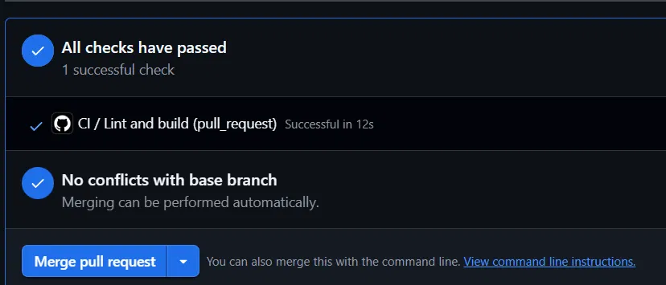

Falha provocada intencionalmente (variável não utilizada, barrada pelo ESLint). O pipeline é obrigatório, e o merge fica bloqueado:

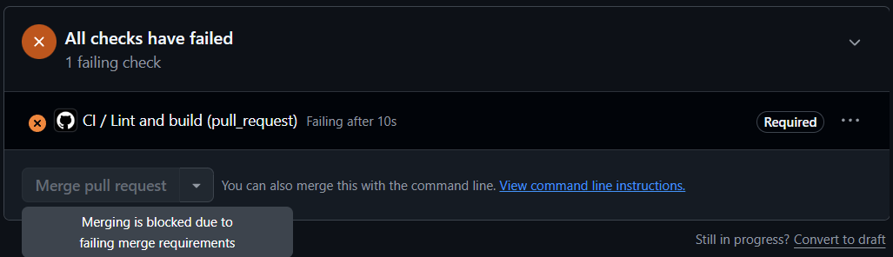

### Testes automatizados e cobertura

Execução dos testes no pipeline, com o relatório de cobertura. As regras do serviço (`src/lib`) estão 100% cobertas:

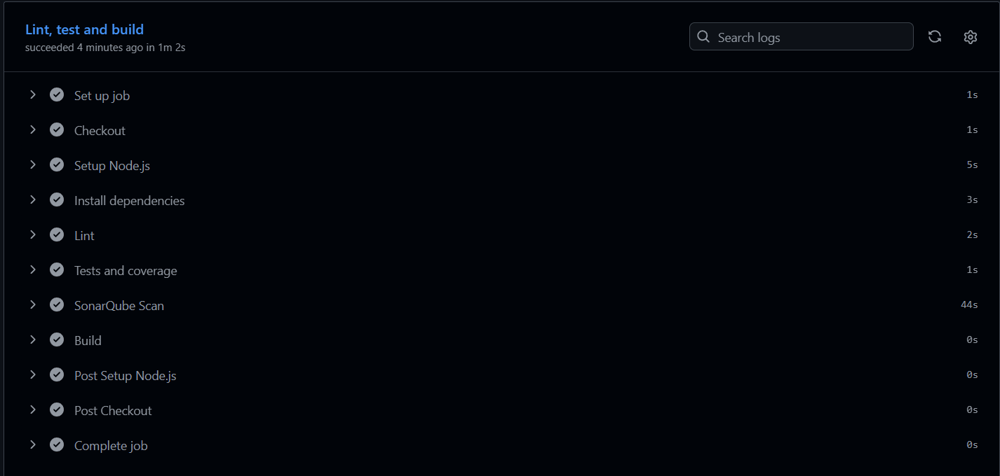

### Qualidade de código

Dashboard do projeto no SonarQube Cloud: Quality Gate aprovado, sem issues e com 100% de cobertura nas regras do serviço:

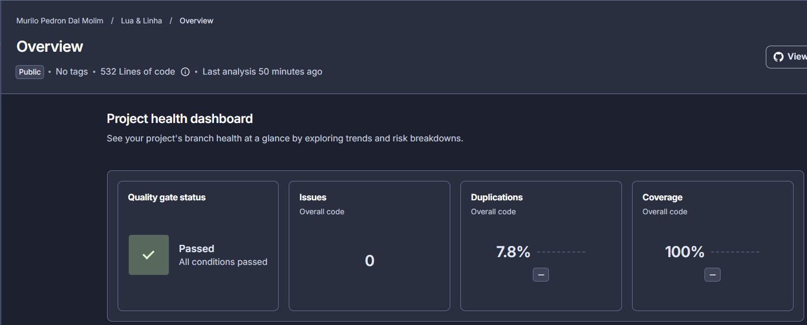

### Segurança

Etapas do pipeline na ordem de execução. A detecção de segredos (Secret scan) e a auditoria de dependências (Dependency audit) acontecem antes do lint, dos testes e do build:

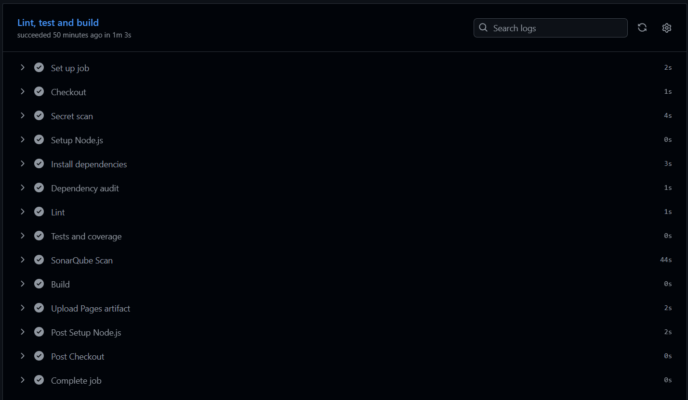

Análise de segurança do código com o CodeQL, sem alertas abertos na `main`:

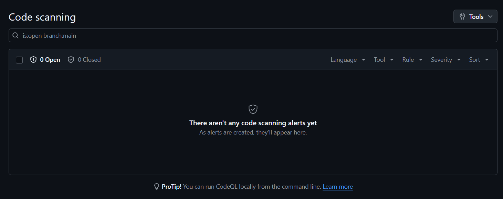

### Deploy

Pull Request com todas as verificações aprovadas. O deploy não é executado em Pull Requests:

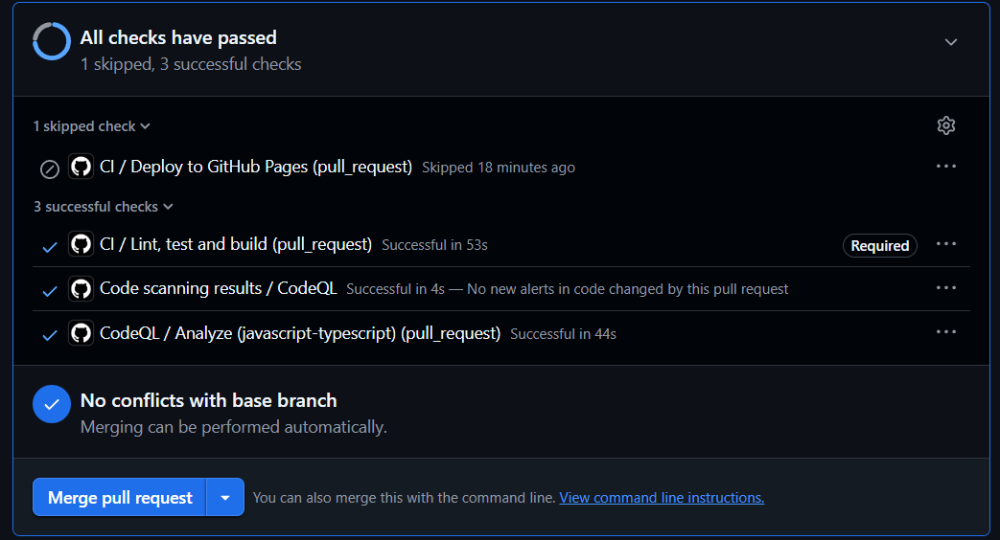

Após o merge na `main`: build, deploy e verificação da aplicação publicada, em sequência:

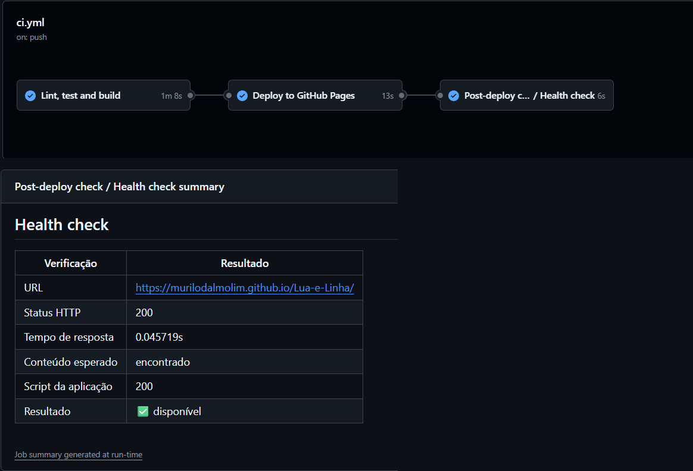

### Monitoramento

Verificação da aplicação publicada:

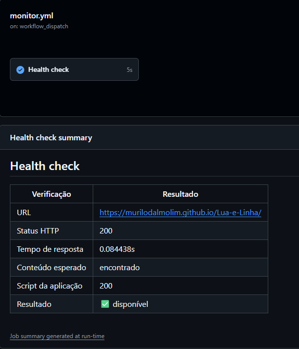

Falha simulada, com uma URL inexistente:

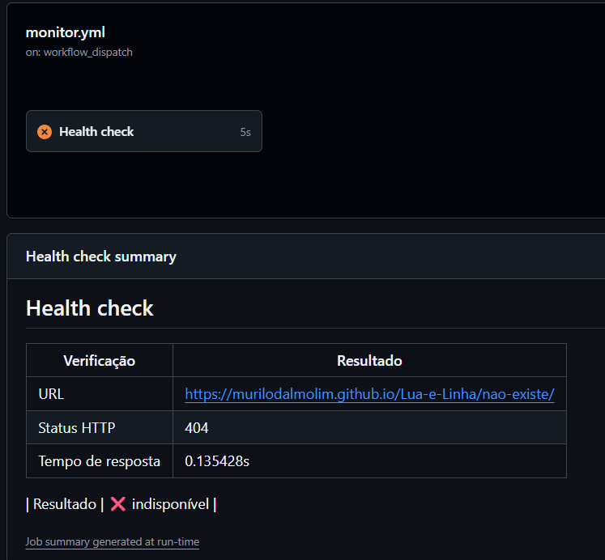

Issue aberta automaticamente pela falha:

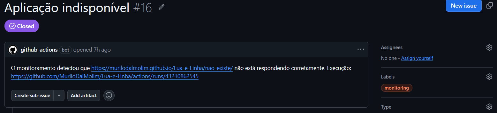

Issue fechada automaticamente quando a aplicação voltou a responder:

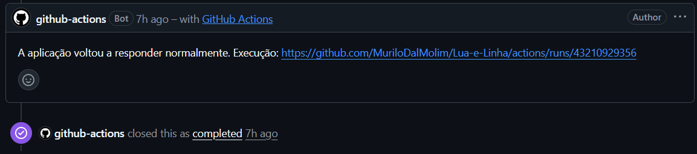

## 16. Como executar o projeto localmente

Pré-requisitos: [Node.js](https://nodejs.org) 22 ou superior e Git.

```bash
git clone https://github.com/MuriloDalMolim/lua-e-linha.git
cd lua-e-linha
npm install
npm run dev
```

Para reproduzir localmente as principais etapas do pipeline:

```bash
npm run lint         # análise de código com o ESLint
npm run coverage     # testes automatizados com cobertura
npm audit            # verificação de vulnerabilidades nas dependências
npm run build        # gera a versão de produção na pasta dist/
npm run preview      # serve localmente a versão gerada pelo build
```

A aplicação ficará disponível no endereço exibido no terminal (por padrão, `http://localhost:5173`).
